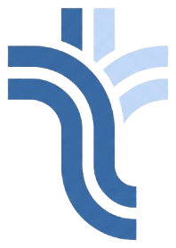

<div align="center">
  
  <h1>worktray</h1>
  <p>Your work, in view.</p>
</div>

worktray is a local dashboard that collects your work from different sources into one view.

> ### Try the demo at [worktray.cloud.run](https://worktray.cloud.run)

## Requirements

- macOS or Linux
- [uv](https://docs.astral.sh/uv/getting-started/installation/)
- A system keyring. macOS has one built in. On Linux, use GNOME Keyring or KWallet.

Some sources need their own command line tool, such as `gh` for GitHub. See [Sources](docs/sources.md).

## Install and run

```sh
uv tool install git+https://github.com/zainsohail88/worktray
worktray serve --open
```

Configure the sources you need in Settings.

## Run from source

```sh
git clone https://github.com/zainsohail88/worktray && cd worktray
uv sync
uv run worktray serve --open
```

## Documentation

| | |
|---|---|
| [Using worktray](docs/features.md) | The tabs and keyboard shortcuts |
| [Sources](docs/sources.md) | What each source reads and what it needs |
| [Configuration](docs/configuration.md) | Settings, environment variables and where data is kept |
| [Commands](docs/commands.md) | The command line, the background service and coding agents |
| [Contributing](CONTRIBUTING.md) | Development setup, adding a source and the design notes |
| [Security](SECURITY.md) | Reporting a vulnerability |
